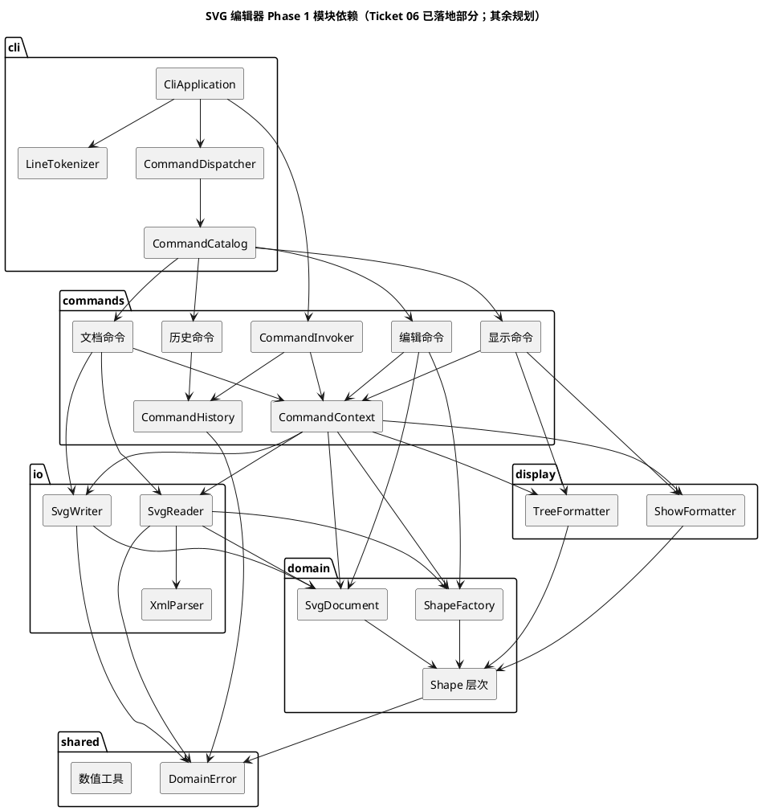

# Lab1 Phase 1：课程报告与过程记录

状态：Ticket 01–06 已实现并通过本地验收，Ticket 15 已于 2026-10-25 完成实现与验收；测试累计 44 个。其余 12 张票仍是计划。Ticket 06 的远端 PR 与合并结果在完成后补充。本报告继续把“计划”和“已实现”分开记录。

需求依据：[课程原始要求](../phase_cli_1.md)。

设计文档：

- [需求规格](./spec.md)：命令语义、错误目录、SVG 支持子集、输出格式。
- [纵向任务计划](./ticket-plan.md)：已批准的 19 张任务、验收与阻塞关系。
- [原 T1–T8](./tasks.md)：保留为历史技术工作清单，不再作为执行顺序。
- [模块依赖图](./architecture.puml) 与 [类模型图](./class-model.puml)：PlantUML 源文件。
- [领域词汇表](../CONTEXT.md) 与 [ADR](../docs/adr/)：已确认的术语和关键决策；Ticket 01 的 CLI 默认见 [ADR-0005](../docs/adr/0005-ticket-01-cli-defaults.md)。

## 架构方案

### 模块划分

| 模块   | 规划目录        | 职责                                          | 允许依赖                            |
| ------ | --------------- | --------------------------------------------- | ----------------------------------- |
| 共享   | `src/shared/`   | 领域错误、错误码、数值解析与格式化            | 无                                  |
| 领域   | `src/domain/`   | 图形层次、文档、id 索引、结构不变量、图形工厂 | `shared`                            |
| 持久化 | `src/io/`       | 最小 XML 解析、SVG 读取子集、SVG 写出         | `domain`、`shared`                  |
| 显示   | `src/display/`  | `tree`/`show` 的树形缩进、显示宽度与格式化    | `domain`、`shared`                  |
| 应用   | `src/commands/` | 命令对象、撤销历史、命令上下文、执行器        | `domain`、`io`、`display`、`shared` |
| 交付   | `src/cli/`      | 分词、命令表、命令分发、REPL、终端输出        | `commands`、`shared`                |
| 装配   | `src/main.ts`   | 组合根：创建并连接以上模块                    | 全部                                |

目标目录结构（Ticket 06 已落地六种内置图形、容器树、命令参数封装与历史相关部分）：

```text
src/
├── main.ts
├── shared/          # DomainError、错误码、数值工具
├── domain/          # Shape/LeafShape/Container/Group/五种叶子
│                    # SvgDocument、ShapeFactory
├── io/              # XmlParser、XmlElement、SvgReader、SvgWriter
├── display/         # TreeFormatter、ShowFormatter
├── commands/        # Command、EditCommand、DocumentCommand、CommandResult
│                    # CommandToken、CommandArguments、CommandHistory、CommandInvoker
│                    # CommandContext、各具体命令
└── cli/             # LineTokenizer、CommandCatalog、CommandDispatcher
                     # CliApplication、ConsoleOutput
```

模块图（PlantUML 组件图，源文件见 [`architecture.puml`](./architecture.puml)）：



关键职责：

- **领域层**不依赖 I/O、终端或命令对象。`SvgDocument` 是聚合根，统一维护 id 索引、父子映射和结构变更；`Group` 通过 `Container` 封装子节点，叶子各自由 `Rect`、`Circle`、`Ellipse`、`Line`、`Text` 负责几何、属性文本和显示描述。
- **持久化层**只处理文件、XML 结构和根元素；图形类型解析仍通过 `ShapeFactory`，不引入第二处类型名分派。
- **显示层**负责树形前缀与兄弟列对齐；图形只提供自己的标签和属性文本。
- **应用层**接收命令对象并执行；执行器只在成功后提交历史影响，命令自己实现正向、撤销和重做。
- **交付层**只做分词、命令名查找、REPL 和输出，不直接操作领域对象。分词器生成带引号来源的 `CommandToken`，由命令层 `CommandArguments` 读取，避免应用层反向依赖 CLI。
- **组合根**在 `main.ts` 创建并注入所有依赖，便于测试时替换 I/O 和输出。

### 设计模式的选择

课程强制要求 **Command 模式**，并要求容器与叶子统一操作。当前落地位置如下：

| 模式            | 落地                                                                    | 作用                                                                |
| --------------- | ----------------------------------------------------------------------- | ------------------------------------------------------------------- |
| Command         | `Command`/`EditCommand`、具体命令类、`CommandInvoker`、`CommandHistory` | 每次分发创建独立命令对象；编辑命令包含撤销/重做，历史只负责调用     |
| Composite       | `Shape` → `LeafShape`/`Container`，`Group` 继承 `Container`             | 当前统一显示子树；后续 `move`/`scale`/`set`/`delete` 等复用同一层次 |
| Factory         | `ShapeFactory`                                                          | 唯一的“类型名 → 类”创建入口；`read` 和 `create` 共用                |
| Template Method | `Shape.setAttribute` 处理公共属性，子类扩展几何属性                     | 公共样式规则只写一次，子类只负责自己的白名单                        |
| Memento         | `GeometrySnapshot`                                                      | move/scale 的撤销保存精确几何，不依赖浮点逆运算                     |

**按名字分派只有两处**：

1. `CommandCatalog`：命令名 → 命令工厂，属于命令分发；每次分发创建独立命令对象，避免历史共享可变执行状态。
2. `ShapeFactory`：图形类型名 → 类，属于图形工厂。

两处都在报告中标注为未来重构点。`set` 不维护全局属性分派表：每个图形类自己维护可设置属性白名单，`set` 命令调用多态的 `setAttribute`。`tree`/`show` 也不需要 `switch(tag)`，由图形类提供自己的文本。

没有采用的模式：

- **快照撤销**：每次编辑复制整份文档，命令类几乎不做事，Command 模式表达力弱；内存随历史增长。改用命令自带反向操作，几何用 Memento。
- **Visitor**：可以为显示/序列化再分一层双分派，但当前只有六种类型和两种输出；先让图形类提供自己的表示，格式显著增多时再重构。
- **事件溯源**：本作业只需要逐步 undo/redo，不需要重建任意历史点。

### 依赖方向规则

| 模块       | 可以依赖                            | 禁止依赖                              |
| ---------- | ----------------------------------- | ------------------------------------- |
| `shared`   | 无                                  | 所有业务模块                          |
| `domain`   | `shared`                            | `io`、`display`、`commands`、`cli`    |
| `io`       | `domain`、`shared`                  | `display`、`commands`、`cli`          |
| `display`  | `domain`、`shared`                  | `io`、`commands`、`cli`               |
| `commands` | `domain`、`io`、`display`、`shared` | `cli`                                 |
| `cli`      | `commands`、`shared`                | `domain`、`io`、`display`（直接依赖） |
| `main`     | 全部                                | 无（组合根）                          |

理由：

- `domain` 是最稳定的核心，不能知道文件、终端或命令名字；这样领域测试不需要临时文件或 stdin。
- `io` 和 `display` 是围绕领域的适配器，只向内依赖；它们之间不互相依赖，读取和显示可以独立测试。
- `commands` 是用例编排层，可以把领域、持久化、显示组合起来；它不依赖 `cli`，所以未来鼠标或 agent 通道可以复用命令对象。
- `cli` 是交付机制，只认识命令表和输出；直接依赖领域会让终端代码绕过命令和历史。
- `main` 是唯一允许知道全部模块的组合根。

违反规则的依赖即为待处理项。实现后按“一致性自查”抽查 import 路径；不引入循环依赖。

### 变化点假设

1. **新增图形类型或插件（`box`）**：最可能变化。留的是 `ShapeFactory` 和 `Shape` 多态；命令只调用 `shape.move()` 等，不按类型分支。`box` 作为 `Container` 子类时，`move`/`delete`/`group` 无需修改。现在不定义 `ShapeProvider`，因为只有一种实现，接口形态是猜的；等真实插件需求出现再把工厂内部换成注册表。
2. **新的交互通道（鼠标、agent）**：留的是命令对象和 `CommandCatalog`。CLI 只负责把一行文本变成命令；另一个通道可以构造同样的命令并交给 `CommandInvoker`。现在不做通道抽象，因为只有一个通道。
3. **SVG 兼容范围（`transform`、任意 `viewBox`、未知元素、`style`）**：变化点集中在 `io`。领域模型保持无变换、画布像素坐标；读取子集拒绝无法保真的结构，避免静默改变画面。现在不做变换支持，因为它会同时影响 `move`/`scale`/`ungroup` 和序列化，超出本阶段；`unsupported ...` 错误是明确的未来入口。
4. **撤销粒度或历史策略**：集中在 `CommandHistory` 和命令的 `undo`/`redo`。IO 屏障、redo 清空、无操作不记录都在执行器和历史中，不散落在 CLI。现在不用事件溯源，因为不需要任意历史点。
5. **显示格式**：`tree`/`show` 需要列对齐、排序或新字段时，先改 `TreeFormatter`/`ShowFormatter` 和图形自己的文本方法；如果格式数量显著增加，再考虑 Visitor。现在不为六种类型引入双分派。
6. **持久化格式**：`SvgReader`/`SvgWriter` 隔离文件与 XML，但图形类提供自己的 SVG 片段。换成 JSON 等格式会触及图形类；这是“图形最了解自己几何”的代价。若出现第二种格式，再引入独立的序列化访问者。
7. **数值精度与格式**：数值解析和格式化集中在 `shared`。现在用 JavaScript 双精度和最短往返十进制表示，不引入十进制库；课程坐标不需要任意精度。
8. **未建模属性**：读取时保留、写出时原样输出、不参与命令。未来要把某个属性升级为建模属性时，需要迁移读取和显示逻辑，但不会破坏已有文件。

### 关键设计决策

| #   | 决策                                                                       | 理由                                     | 记录                                                      |
| --- | -------------------------------------------------------------------------- | ---------------------------------------- | --------------------------------------------------------- |
| 1   | 方案先行，需求澄清后再实现                                                 | 课程报告要求方案与自查；避免边写边改语义 | 本报告                                                    |
| 2   | 零运行时依赖，自写 XML 解析器和分词器                                      | 控制支持子集、错误和往返；课程重点在 OOP | [ADR-0001](../docs/adr/0001-zero-runtime-dependencies.md) |
| 3   | `Shape` 继承体系 + `LeafShape`/`Container`；画布不是图形                   | 多态、Composite、一类一文件；画布无 id   | 本报告                                                    |
| 4   | 校验先行 + 领域异常；失败不改变文档/历史                                   | 原子性最容易审计                         | 本报告                                                    |
| 5   | 命令自带反向操作；几何用 Memento                                           | 体现 Command；精确撤销；比快照省内存     | 本报告                                                    |
| 6   | 本阶段不做插件框架；`ShapeFactory` 是扩展缝                                | 只有一种实现，空接口是猜测               | 本报告                                                    |
| 7   | 读取只接受支持子集，拒绝 `transform`/`style`/未知视觉元素/不匹配 `viewBox` | 不静默改变画面；领域模型无变换           | [ADR-0002](../docs/adr/0002-supported-svg-subset.md)      |
| 8   | `group` 以第一个 id 为父级和位置锚点，子节点按命令行顺序                   | 规则简单；与课程错误例子一致             | [ADR-0004](../docs/adr/0004-group-anchor-rule.md)         |
| 9   | 文档命令清空历史并锁定；下一次改变状态的编辑解锁                           | 不跨 IO 撤销；避免悬空命令引用           | [ADR-0003](../docs/adr/0003-io-history-barrier.md)        |
| 10  | 无操作命令成功但不进历史、不解锁                                           | 无状态变化不产生撤销单元                 | [spec.md](./spec.md) 2、9                                 |
| 11  | 尺寸类 > 0，坐标可为负，`scale` 因子 > 0                                   | SVG 几何边界；避免不可见零尺寸图形       | [spec.md](./spec.md) 3、5                                 |
| 12  | 根必须有宽高；`viewBox` 缺失或恰为 `0 0 w h`                               | 不引入未建模的坐标缩放                   | [spec.md](./spec.md) 7                                    |
| 13  | Ticket 01 采用 TTY 提示、stdout 输出和 `init` 直接替换默认                 | 先收口本票所需契约，不推定其余 C1 条目   | [ADR-0005](../docs/adr/0005-ticket-01-cli-defaults.md)    |

## 需求摘要

- 通过 REPL 操作 SVG；`#` 注释、双引号参数、脚本回放。
- 六种内置类型：`rect`、`circle`、`ellipse`、`line`、`text`、`g`；`box` 属于后续插件阶段。
- id 唯一、大小写敏感；外部 SVG 缺 id 按 `<标签名><序号>` 自动补并警告。
- 覆盖文档操作、图形编辑、分组与层级、z-order、结构与属性显示、撤销重做。
- 一条编辑命令一个撤销单元；失败不改变状态；IO 与画布尺寸修改后禁止撤销，直到下一次编辑。
- TypeScript 面向对象、字段封装、多态、一类一文件；避免贫血模型和散落的类型分派。
- Git 分步提交并推送；最终验收后创建 `final` 标签；报告包含架构、过程、自查和质量保证。

完整命令语义见 [spec.md](./spec.md)。

## 过程记录

### 2026-10-19：工程初始化

- 用户要求先阅读作业并初始化项目，具体需求和实现后续讨论。
- 初始目录只有 `phase_cli_1.md`，没有 Git 仓库和工程配置。保留该文件原文，并单独提交原始要求作为基线。
- 采用本机可用的 Node.js 24.x、npm、TypeScript 和 ESM；开启严格类型检查，通过 tsx 运行开发入口。
- 配置编译、测试入口、格式化及统一检查命令，锁定开发依赖版本；使用 Node.js 内置测试运行器。
- 仅建立可运行的启动占位类，没有实现编辑命令、图形模型、撤销历史或 SVG 读写。
- 初始化验证通过：`npm run check` 完成类型检查、格式检查、测试入口检查（0 个测试）和构建；`npm run cli`、`npm start` 均正常输出占位信息并退出。原始要求文件与基线提交一致。
- 远程仓库尚未配置；`final` 标签留到最终验收后创建。

### 2026-10-22：补充智能体协作说明

- 按用户要求补充 `AGENT.md` 和 `CLAUDE.md`，同时提供 `AGENTS.md` 作为协作规则的唯一维护来源，两份入口均引用它。
- 规则涵盖需求资料的阅读时机、阶段范围、课程范式与设计模式约束、验证方式、报告更新和 Git 交付要求。
- 本次仅补充协作文档；业务需求与架构仍待后续讨论。

### 2026-10-22：需求访谈与架构设计

- 用户要求先访谈、先澄清术语，再逐步完成方案设计。按“方案先行”确定顺序：需求澄清 → 拆分需求 → 初步方案 → 详细设计 → 规格与任务 → 实现。
- 访谈分为多轮，每轮只问当前可回答的决策，并给出推荐：
  - Q1 交付边界：先设计、确认后实现。
  - Q2 依赖策略：零运行时依赖。
  - Q3/Q3b 图形模型：继承体系；画布不是图形容器。
  - Q4/Q5 错误与撤销：校验先行 + 领域异常；命令自带反向操作。
  - Q6 插件预留：本阶段不做插件框架，保留 `ShapeFactory`。
  - Q7–Q9 SVG 读取：拒绝 `transform`；拒绝会改变画面的未知元素、忽略元数据；保留无害未知属性，拒绝 `style`。
  - Q10–Q12 树结构：`group` 以第一个 id 为锚点；子节点按命令行顺序；边界 `front`/`back` 是无操作。
  - Q13–Q17 文档生命周期：文档命令清空历史并锁定；`save` 更新当前路径；`init`/`canvas` 成对参数和正尺寸；几何数值边界；根 `viewBox` 必须匹配。
- **过程修正**：第一轮 Q3–Q6 使用了较多“继承、接口、原子性、Memento”等术语，用户明确表示难以理解，要求“先澄清后提问”。随后改用具体命令和树结构解释每个选择，把术语第一次出现时的含义写清楚，并把问题拆成一轮一个主题；术语在确定时同步写入 `CONTEXT.md`。这次修正发生在写代码之前，避免了按错误理解实现。
- **被否决的替代方案**：快照撤销（弱化 Command、内存开销）、跨 IO 保留历史（悬空对象、语义模糊）、原样保留 `transform`（`ungroup` 和命令语义冲突）、总是把新组放画布根（破坏局部层级）、现在定义 `ShapeProvider`（只有一种实现，接口是猜测）、跳过未知元素并警告（保存时静默丢画面）。
- 产出：`CONTEXT.md`、`doc/spec.md`、`doc/tasks.md`、两张 PlantUML 源文件、四份 ADR，以及本报告。
- 当前仍是**设计完成、实现未开始**；`src/` 只有启动骨架，业务测试为 0。下一步按 `doc/tasks.md` 的 T1–T8 实现。

### 2026-10-23：访谈文档简要验收

- 范围：对照课程原文核查规格、术语、四份 ADR、架构图和任务计划；本次是文档验收，不是业务功能验收。
- 结论：访谈产物已足以进入规格收口与任务拆票；尚不作为直接开始整套实现的通过依据。按 `ask-matt` 流程，下一步利用已有规格完成 `/to-spec` 收口，再通过 `/to-tickets` 形成可独立执行的纵向任务。
- 实现前需收口：
  1. `spec.md` 第 2 节及 `tasks.md` 仍标注“补充默认待确认”，与根 README 和本报告开头的“设计完成”状态不一致；应明确哪些是已确认决策、哪些是可采用的实现默认。
  2. 课程命令表要求 `group`“保持相对顺序”，规格 6.6 和 ADR-0004 则采用命令行顺序。原同级为 `a,b` 时执行 `group g b a`，两种解释会产生不同结果。需明确课程约束的解释，并同步规格与 ADR；已接受的 ADR 不能单独证明与课程一致。
  3. 任务表没有明确分配 `InitCommand`、`ReadCommand`、`SaveCommand`、`CanvasCommand`、`UndoCommand`、`RedoCommand` 的实现责任；T2 的历史基础设施和 T6 的读写器不能替代这些用例。当前 T1–T7 主要按技术层拆分，首个 CLI 端到端验证集中在 T7；正式拆票时应先形成一条可运行的最小命令链，再逐步扩展，并记录阻塞关系。
- 次要文档修订：规格 7.2 同时写了“忽略 CDATA”和“text 接受 CDATA”，需明确按所在元素处理；规格 6.9 应明确 front/back 与子节点索引、绘制顺序的对应关系；类图中的公开字段需标明只读访问或封装方式，避免与字段封装规则冲突。
- 环境记录修订：根 README 仍写远程未配置，但本次 `git remote -v` 已显示 `origin` 为 `git@github.com:NQC233/svg-editor-lab1.git`；仅确认配置存在，未核查推送状态。早期初始化记录保留为当时事实。
- 验证：`npm run format:check` 通过；检查 10 份项目文档中的本地 Markdown 链接，无失效目标；`git diff --check` 通过。当前仍只有两个启动骨架源文件，没有业务测试；未进行业务验收。

### 2026-10-23：纵向拆票准备

- 用户指定 `to-tickets` 与 `architecture-coach`，以现有规格为输入准备拆票；本轮处于事实调查和切片讨论阶段，尚未批准任务拆分、发布 Issues 或开始业务实现。
- 已核对课程原文、规格、原 T1–T8、领域术语、四份 ADR、类图和启动骨架。原任务主要按技术层划分，后续拆票需为每张票明确可观察行为、验收、真实阻塞依赖及原因、影响模块/接口、风险和人工审核重点。已有模块依赖方向继续适用。
- 规格收口范围沿用上一节：补充默认的状态、group 顺序与课程措辞的关系、CDATA 所在元素的处理规则、front/back 的索引与绘制顺序，以及类图的封装表达。新增发现：规格 11.5 的 create 撤销输出是 `rect#r2 deleted`，而第 9 节规定为 `rect#r2 removed`，编写黄金输出验收前需统一。
- 受影响范围：group 顺序影响分组验收；front/back 顺序影响层叠验收；CDATA 影响读取验收；补充默认按 CLI、历史、读取等各自使用范围落实，不能把“待确认”自动写成已批准。无操作不解锁历史已在 ADR-0003 接受，其与补充默认的状态重复应消除。
- 只读核查：远端为 `NQC233/svg-editor-lab1`，当前 Issues 列表为空；`ready-for-agent` 标签尚不存在。发布阶段按仓库约定使用 GitHub Issues 和原生阻塞关系，准备标签；受阻票不标记为可直接领取。
- 技能兼容检查：本地上游 28 份资料与已审阅基线一致。本轮学习问题是最小命令链中撤销/重做的交付时机，已邀请用户预测，尚无回答或选择记录。
- 本轮未执行业务测试；业务代码仍为启动骨架，不能把文档调查作为功能验收。

### 2026-10-23：细粒度切片初稿

- 用户回答：撤销/重做留到后续票，希望每票拆得更细。这确认交付粒度偏好，不代表完整任务列表已批准。
- 按此形成[纵向切片草案](./ticket-plan.md)：先空画布会话，再创建/观察矩形，第三票接入撤销重做；后续每个编辑票一并验收自身历史行为。
- 取舍：拆开减少首次评审涉及的状态，但早期创建票尚未达到课程最终编辑验收。第一票即使用命令对象与执行器，第三票用真实创建回放验证历史接入；不先建全套六类型和 IO 基础设施。
- 草案列出 19 张票的交付、验收、直接依赖及原因、模块/接口、风险与人工审核重点，并单列未决契约对应的受阻范围。原 T1–T8 暂保留，避免把草案当成已确认计划。
- 当前只完成文档拆分，未发布 GitHub Issues，未执行功能测试，也未将用户尚未回答的语义问题写成已确认。

### 2026-10-23：拆分批准、feat 分支规则与票据发布

- 用户批准 19 张票的粒度与阻塞关系，并明确要求：功能实现不能直接修改 main，必须新建 feat 分支。已将实现前新建并切换 `feat/<功能或票据名>` 的规则写入 AGENTS.md，作为唯一维护来源。
- 本轮规划整理已切换到 `feat/ticket-planning`；保留工作区原有修改和 AGENT.md 的既有删除，未开始业务实现。
- 按已批准的 to-tickets 流程发布 [GitHub Issues #1–#19](https://github.com/NQC233/svg-editor-lab1/issues)，设置 38 条原生阻塞关系；完整映射见[发布索引](./ticket-plan.md#发布索引)。每张 Issue 都包含交付、验收、相关规格摘录、依赖、风险、人工审核重点和 feat 分支要求。
- 内容存在未决语义的票标记 needs-info；其他票仍等待前置完成，当前没有 ready-for-agent 任务。拆分批准没有被扩大解释为对补充默认或课程歧义的批准。
- 原 T1–T8 保留为历史清单；当前实施入口统一指向 19 张纵向任务，规格语义未在本轮擅自改变。
- 发布中发生一次连接超时，回读实际状态后恢复，未重复创建票据。发布完成后逐票回读：19 张票的标题、正文、标签、分支要求一致，38 条原生依赖与计划逐边一致。
- 本轮为文档与 tracker 变更，未运行或宣称通过业务测试；本地文档尚未提交或推送。

### 2026-10-25：Ticket 01 空画布命令会话

- 用户要求实现 Ticket 01。该实现指令被记录为本票所需 C1 默认的采纳决定：横幅与提示符仅 TTY 输出、结果/警告/错误统一 stdout、`init` 直接替换文档；其余 C1 条目仍不由本票推定。决定写入 ADR-0005。
- 按 TDD 依次在分词、命令分发和真实 CLI 接缝写失败测试，再补最小实现。当前有 11 个测试，覆盖引号/转义/注释/未闭合引号、数值边界、`help` 完整目标语法、`init` 默认与显式尺寸、失败原子性、无文档错误、TTY 横幅/提示符、空白脚本以及 EOF。
- 实现采用 `Command` → `CommandInvoker` → `CommandContext` → `SvgDocument` 的命令链；`CommandCatalog` 是当前唯一的命令名分派点，`main.ts` 是唯一组合根。终端只负责分词、分发和输出，不直接修改领域对象。
- 双轴审查发现初版把带参数 `canvas` 的尺寸修改提前带入了 Ticket 01，且 `CliApplication` 自行装配依赖。修正后带参数 `canvas` 明确报 `canvas resizing is not available yet` 并保持状态不变，留给 Ticket 15；组合根移到 `main.ts`。
- PR 集成复审进一步收口组合根：`main.ts` 现在显式创建命令、命令表、分词器和输出适配器并注入 `CliApplication`；同时补齐引号/反斜杠、注释、空白脚本和数值边界验收。
- 验证：`npm run check` 通过（类型、格式、11 个测试、构建）；`npm run cli` 回放 `help`、`init 320 240`、`canvas` 得到完整帮助和 `canvas 320x240`；构建后的 `npm start` 回放 `init`、`canvas` 得到 `canvas 800x600`。
- 当前范围仍只是 Ticket 01，不包含图形创建、SVG 读写、撤销重做或带参数 `canvas`；因此不能据此宣称 Phase 1 完成。

### 2026-10-25：Ticket 02 创建并查看矩形

- 开始前复核分支拓扑：远端当时只有 `main`，且 `origin/main` 不包含 Ticket 01；直接将本地 `main` 更新到远端会丢失 Ticket 02 的前置。由于 Ticket 01 尚未合入 `main`，先把 `feat/ticket-01-cli-session` 补推到远端，再以该分支末端 `e02ddbb` 作为 `feat/ticket-02-rect-create` 的堆叠基准，没有重做 Ticket 01。
- 按 TDD 在命令分发和真实 CLI 两个 seam 先写失败用例，再补最小实现。新增测试覆盖显式尺寸与可选填色、负数/浮点坐标、根级插入顺序、大小写敏感 id、重复 id、未知类型、非法数值、非法 id、缺失目标、失败原子性、`tree <id>` 与颜色 `#` 不被误判为注释。
- 领域层新增 `Shape` → `Rect` 多态层次和唯一类型工厂 `ShapeFactory`；`SvgDocument` 负责 id 索引、根级顺序和插入。`Rect` 封装几何与填色，自行提供 tree/show 文本片段，不在命令或格式化器中按 `rect` 分支。
- 显示层新增 `TreeFormatter` 与 `ShowFormatter`。树形输出按同组最长标签宽度加两个空格对齐；`show` 输出父级 `svg`、完整几何属性和已设置的 `fill`。
- 失败路径均在状态写入前完成参数、id、几何和工厂校验；重复 id 由 `SvgDocument` 的索引再次拒绝。本票没有加入 undo/redo、`create … in`、容器、其他五种图形或 IO，这些行为留给各自票据。
- 双轴审查发现初版由命令自行装配工厂/格式化器，且树对齐使用 UTF-16 长度而误解宽字符。依赖装配已集中回 `main.ts` 并注入 `CommandContext`；新增 `DisplayWidth` 按终端显示宽度对齐，真实 CLI 回放也补齐了非法数值、尺寸、id、填色和未知类型。
- PR 集成复审进一步把 `create` 命令名从领域 usage 文案移回命令层，由 `ShapeUsageError` 只携带图形参数语法；同时统一在数值解析入口去除首尾空白，并补充矩形坐标空白回放。
- Ticket 01 通过 PR #20（merge commit `311409e`）进入 `main` 后，Ticket 02 已 rebase 到最新主线；与 Ticket 01 的组合根和 11 个既有测试合并后，当前测试基线为 16 个。
- 验证：`npm run check` 通过（类型、格式、16 个测试、构建）；`npm run cli` 和构建后的 `npm start` 回放见下方质量证据。

### 2026-10-25：PR 集成与 Ticket 03 契约收口

- Ticket 01 经 [PR #20](https://github.com/NQC233/svg-editor-lab1/pull/20) 合入 `main`（`311409e`）；Ticket 02 经 rebase 后由 [PR #21](https://github.com/NQC233/svg-editor-lab1/pull/21) 合入（`e5c71b5`）。两条主线的分步提交历史均保留。
- 集成复审补齐了 Ticket 01 的唯一组合根、引号/转义/注释与数值边界测试；Ticket 02 复审补齐了数值首尾空白处理，并把 `create` 命令名从领域 usage 文案移回命令层。
- Ticket 03 C1 收口：无操作编辑成功返回，但不记录历史、不清空 redo、不解除历史屏障，采用已接受的 [ADR-0003](../docs/adr/0003-io-history-barrier.md)。
- Ticket 03 C2 收口：`create` 的撤销摘要统一为 `<type>#<id> removed`；`deleted` 只用于 `delete` 命令。规格 11.5 示例已同步，Issue #3 已标记为 `ready-for-agent`。
- 本轮只收口契约和集成状态，未实现 undo/redo；Ticket 03 的业务代码应在下一步从最新 `main` 新建 `feat/` 分支。

### 2026-10-25：Ticket 03 撤销与重做矩形创建

- 开始前确认本地与远端 `main` 同为 `6599311`，Ticket #2 已合入并关闭，Ticket #3 带 `ready-for-agent`。随后从最新 `main` 新建 `feat/ticket-03-undo-redo`，没有在 `main` 上修改业务代码。
- 按 TDD 先在命令分发与真实 CLI 两个接缝写失败用例，再补最小实现。新增测试覆盖矩形创建的一次撤销/重做、undo 后 id 不存在、redo 恢复属性与根级顺序、redo 分支被新编辑清空、无文档、空栈、`init` 成功屏障、`init` 失败保留历史，以及显示和失败编辑不破坏 redo。
- 命令协议增加 `DocumentCommand` 和 `CommandResult`：`DocumentCommand` 以类层次表达建立屏障的文档命令，`CommandResult` 显式携带输出与“是否改变状态”。`CommandInvoker` 只在成功返回后提交历史影响；文档命令成功后清空并锁定历史，编辑命令改变状态后记录并解锁，显示和历史命令不修改历史。
- `CommandCatalog` 从保存命令实例改为保存命令工厂，每次分发创建独立命令对象。这样 `CreateCommand` 可以封装自己的创建位置与图形引用，连续创建不会因为共享实例而覆盖历史状态；命令名分派仍是唯一分派点。
- `CreateCommand` 继承 `EditCommand`，撤销输出 `<type>#<id> removed`，重做输出原创建摘要；`SvgDocument.insertShape`/`removeShape` 负责索引和 id 索引的一致提交，redo 按原索引插回。
- `CommandHistory` 维护 undo/redo 栈和屏障状态。undo/redo 只有在文档存在后检查、锁定时统一报 `undo not allowed after io command`，空栈分别报 `nothing to undo`/`nothing to redo`；新编辑清空 redo。
- 真实 CLI 回放覆盖撤销后树与 `show`、redo 恢复、双次 undo、`init` 前后屏障和失败命令保留 redo。21 个测试全部通过；入口和构建验证见质量证据。
- 双轴审查发现初版执行器同时依赖 `CommandKind` 和 `instanceof EditCommand`，分类来源不一致时可能漏记历史。已删除 `CommandKind`，新增 `DocumentCommand` 基类，只由命令类层次决定历史提交；测试装配提取到 `test/support/`，并让 `npm test` 显式匹配 `test/**/*.test.ts`，避免辅助文件被计为测试。
- Ticket 03 通过 [PR #23](https://github.com/NQC233/svg-editor-lab1/pull/23) 合入 `main`，merge commit 为 `c232787`；Issue #3 已关闭，临时功能分支已删除。

### 2026-10-25：Ticket 04 创建圆、椭圆与直线

- 开始前 fetch 远端并确认本地 `main` 与 `origin/main` 同为 `b3269b0`，Ticket #3 已关闭且无待确认内容门禁；随后从最新 `main` 新建 `feat/ticket-04-geometry-shapes`。
- 按 TDD 分成圆、椭圆、直线三个纵向循环：每个循环先写命令层失败测试，再补对应图形类与 `ShapeFactory` 构造。`CreateCommand`、`CommandInvoker`、`CommandHistory` 和 tree/show 格式化器保持不变，新增类型没有引入命令或显示层的类型分支。
- 三个图形类分别封装中心、半径、端点和可选样式；`Circle`/`Ellipse` 支持可选 `fill`，`Line` 支持可选 `stroke`。类型工厂仍是唯一的“类型名 → 类”分派点，帮助文案同步声明已支持四种叶子图形。
- 新增测试覆盖三种类型的创建、tree/show、一次撤销与重做、默认样式省略、浮点及负坐标、半径约束、非法数值、非法样式、参数个数和失败不改变文档；真实 CLI 回放还验证失败创建之后 undo/redo 仍然可用。
- 双轴审查发现四个叶子图形直接继承 `Shape`，与已确认的 `Shape → LeafShape` 架构不一致，且重复实现公共样式校验与文本片段。已新增 `LeafShape` 基类，集中封装可选 `fill`/`stroke`、非空样式校验和有限数值校验，并让四个叶子类改由它继承；创建命令、历史与显示格式化器仍无类型分支。
- 审查还提出坐标字段成组出现。本票暂不引入 `Point`/`Segment`：当前只有构造与文本显示，尚无共享的几何变换行为；待 move/scale 票出现实际复用需求时再评估，以免为单票增加推测性抽象。
- Ticket 04 通过 [PR #25](https://github.com/NQC233/svg-editor-lab1/pull/25) 合入 `main`，merge commit 为 `7c9a366`；Issue #4 已关闭。
- 本票未实现 `text`、`g`、`create … in`、move/scale/set、SVG IO 或带参数 `canvas`；这些仍由后续票负责。

### 2026-10-25：Ticket 05 创建与显示文本

- 开始前 refresh 远端并确认本地 `main` 与 `origin/main` 同为 `b047ddf`，Ticket #3 已关闭、Ticket #5 无 `needs-info` 门禁；随后从最新 `main` 新建 `feat/ticket-05-text-create`，并把 #5 标记为 `ready-for-agent` 后领取。
- 按 TDD 先补命令层、分词器和真实 CLI 失败用例，红灯为 33 个测试中 10 个失败；再补最小实现。新增 7 个测试，覆盖文本创建、中文、空内容、空格、引号、反斜杠、换行/制表符 JSON 转义、内容为 `in`、错误输出、失败原子性、撤销重做和分词引号元数据；其中换行/控制字符测试由审查后补。
- 领域层新增 `Text` 类并接入唯一类型工厂 `ShapeFactory`；`Text` 封装坐标与内容，自行提供 tree/show 文本，命令和格式化器没有新增类型分支。tree/show 使用 JSON 字符串表示内容，统一处理双引号、反斜杠、换行和控制字符。
- 分词器改为生成 `CommandToken`，保留每个 token 是否来自引号段的信息；命令层新增 `CommandArguments` 作为只读参数封装，所有命令通过值访问参数。这样 Ticket06 解析未加引号的 `in` 后缀时，不会把 `create text … "in"` 的内容误判为语法关键字，同时保持 `commands` 不依赖 `cli`。
- 双轴审查发现文档状态未同步、换行/控制字符转义缺少直接测试，以及分词测试重复投影逻辑。已更新 README、任务计划、测试说明和本报告，补齐转义测试并提取测试辅助函数；`CommandToken.quoted` 暂无生产消费者，但由 Ticket06 的已记录接口需求保留。
- 验证：`npm run check` 通过（类型、格式、34 个测试、构建）；`npm run cli` 与构建后的 `npm start` 使用同一文本脚本回放创建、tree/show、undo/redo，去掉 npm 自身脚本横幅后应用输出一致，stderr 为空。
- Ticket 05 通过 [PR #27](https://github.com/NQC233/svg-editor-lab1/pull/27) 合入 `main`；Issue #5 随 PR 关闭。
- 本票未实现 `g`、`create … in`、move/scale/set、SVG IO 或带参数 `canvas`；这些仍由后续票负责。

### 2026-10-25：Ticket 15 修改画布尺寸并建立历史屏障

- 开始前确认工作区干净，本地 `main` 与 `origin/main` 同为 `2b99f42`；Ticket #15 的唯一前置 #3 已关闭，规格没有额外待确认项。从最新 `main` 新建 `feat/ticket-15-canvas-resize`，并在实现前把 #15 标记为 `ready-for-agent` 后领取。
- 按 TDD 先写命令分发接缝的成功用例，红灯为 `canvas resizing is not available yet`；再补最小实现转绿。随后补齐两个历史切片，分别覆盖无参数查询不破坏 redo、成功缩放清空并锁定旧历史、下一次创建解锁，以及非法尺寸/数值/参数不改画布、图形和已有历史。
- `CanvasCommand` 改由 `DocumentCommand` 继承，但保留双重语义：无参数查询返回 `changed=false`，执行器因此不建立屏障；带参数缩放返回 `changed=true`，沿用既有文档命令协议清空并锁定历史。没有引入第二套命令分类或新的名字分派。
- `SvgDocument.resize` 在写入前同时校验宽高为有限正数，提交时只替换画布尺寸，不触碰根图形和 id 索引。非法尺寸在赋值前失败，因此画布、图形与历史保持原状。
- 同步移除帮助中的“缩放未实现”说明，并更新脚本回放、命令测试、README、任务计划、测试说明和类模型；类图把 `CanvasCommand` 归入 `DocumentCommand` 继承关系。
- 双轴审查发现规格状态未同步、真实 CLI 对屏障/失败保留历史的覆盖不足，以及 `canvas` 缺少非有限数的直接回归测试。已同步 `doc/spec.md`，新增独立 CLI 回放并补充 `NaN`、`Infinity` 和溢出值断言。
- 验证：`npm run check` 通过（类型、格式、38 个测试、构建）；`npm run cli` 与构建后的 `npm start` 分别回放成功缩放、屏障错误、下一次编辑解锁、非法缩放和树状态。
- 本票未实现容器、SVG IO、其余编辑命令或完整 Phase 1 验收；这些仍由后续票负责。

### 2026-10-25：Ticket 06 容器内创建与树形查看

- 开始前 fetch 远端并确认本地 `main` 与 `origin/main` 同为 `1599ae5`，Ticket #3 已关闭且 Ticket #6 无待确认内容门禁；从最新 `main` 新建 `feat/ticket-06-container-create`，将 #6 标记为 `ready-for-agent` 后领取。
- 按 TDD 分成四个纵向切片：空 `g` 创建与显示；`create … in` 的归属、索引和 undo/redo；六种内置类型的多层树及失败原子性；真实 CLI 成功/失败回放。先写接缝测试，再补最小实现。
- 领域层新增 `Container` 与 `Group`，`Shape` 通过多态 `childShapes()` 统一表达“可能有子树”；`SvgDocument` 维护父子映射、根级/容器内插入、完整子树的 id 注册与移除，并集中返回 `no such container` / `not a container`。子节点变更需要文档持有的内部能力键，直接改 `g` 会被拒绝；领域测试验证该不变量。
- `ShapeFactory` 仍是唯一的图形类型名分派点，新增 `g` 构造；`CreateCommand` 解析末尾未加引号的 `in <containerId>`，保存父容器与原索引供 undo/redo 精确恢复，并保留 `CommandToken.quoted` 以区分文本内容 `"in"` 和语法后缀。未加引号的 `in` 若未完整构成后缀则报 usage，不能被当作 fill/stroke 或文本内容。
- `TreeFormatter` 使用图形自己的 `childShapes()` 递归，按每组兄弟的最长标签宽度加两空格对齐；`tree <id>` 以目标图形为根显示局部子树，`show` 通过文档父子映射显示 `parent=svg` 或 `parent=g#id`。
- 命令测试覆盖空容器、嵌套容器、六种类型后缀、局部 tree/show、兄弟对齐、撤销重做后的父级与索引、缺容器、非容器、重复 id、非法后缀、裸 `in` 占用参数槽、被引号保护的 `in`，并断言失败后树和已有 redo 不变。真实 CLI 回放独立验证相同成功链与失败链。
- 验证：`npm run check` 通过（类型、格式、44 个测试、构建）；`npm run cli` 与构建后的 `npm start` 使用同一容器脚本回放成功创建、局部 tree/show、undo/redo、非容器、重复 id 与非法 `in` 失败，两个入口输出一致且 stderr 为空。
- 本票未实现 move/scale/set/delete/group/ungroup/addto/front/back、SVG IO 或完整 Phase 1 验收；`Container` 的子节点变更接口目前只由 `SvgDocument` 调用。

## 一致性自查

当前状态为“Ticket 01–06 已实现并通过本地验收，Ticket 15 已实现并验证；其余能力仍为计划”。

1. **模块划分**：已落地 `src/shared/`（错误与数值）、`src/domain/`（`Shape`、`LeafShape`、`Container`、`Group`、`Rect`、`Circle`、`Ellipse`、`Line`、`Text`、`ShapeFactory`、`SvgDocument`）、`src/display/`（`TreeFormatter`、`ShowFormatter`、`DisplayWidth`）、`src/commands/`（命令、token/参数封装、结果、历史、上下文、执行器、create/canvas/tree/show/undo/redo）、`src/cli/`（分词、命令表、分发、REPL、输出）与 `src/main.ts`（组合根）。`io/` 和其余编辑命令仍为计划，与当前票边界一致。
2. **依赖方向**：抽查 import 后，`domain` 只依赖 `shared`；`display` 依赖 `domain` 和 `shared`；`commands` 依赖 `domain`、`display` 和 `shared`；`cli` 依赖 `commands` 和 `shared`；`main` 装配全部模块。`commands` 不 import `cli`，`cli` 不直接 import `domain`/`display`，未发现循环依赖。
3. **名字分派**：当前只有两处名字分派，符合课程约束：`CommandCatalog` 做命令名到命令工厂的分派，`ShapeFactory` 做图形类型名到类实例的分派。命令和格式化器中没有第二套类型 `switch`。
4. **规格一致**：Ticket 01 按规格 3.1、3.3、4.1–4.3、6.11、6.14、6.17 实现；Ticket 02 按规格 3.1–3.3、5.1–5.2、5.5–5.6、6.1、6.15–6.16 实现；Ticket 03 按规格 3.3、6.10–6.11、9 实现；Ticket 04 按规格 3.1、3.3、5.1–5.2、5.5–5.6、6.1、6.10 实现；Ticket 05 按规格 3.1、4.2、5.2、5.5–5.6、6.1、6.10、9 实现；Ticket 06 按规格 3.2–3.3、4.2、5.2、5.5–5.6、6.1、6.10、9 实现；Ticket 15 按规格 3.3–3.4、6.10、6.14 实现。测试名称引用对应章节；当前 undo/redo 覆盖六种内置类型创建，其他编辑命令仍需各自交付历史。
5. **文档一致**：`CONTEXT.md`、`doc/spec.md`、`doc/ticket-plan.md`、ADR-0005 与本报告一致；未实现的 IO、几何编辑、结构编辑和其余显示细节没有写成已完成。

## 质量保证手段

### 计划

- **领域单元测试**：六种图形的 move/scale/set/属性读取、几何快照恢复；`Group` 递归；id 索引和子树删除/恢复。
- **命令单元测试**：每条命令的成功、失败、撤销、重做、无操作；失败前后文档树快照一致。
- **历史测试**：记录、undo/redo、redo 清空、IO 屏障、锁定时错误、空栈错误。
- **SVG 测试**：XML 词法/结构、有效和无效 fixture、自动补 id 警告、重复 id、`transform`/`style`/未知元素/`viewBox` 拒绝、读写往返、转义和属性顺序。
- **CLI 测试**：分词（引号、转义、注释、颜色 `#`）、命令表、TTY/非 TTY 行为、错误前缀、脚本回放。
- **端到端**：`phase_cli_1.md` 的基础会话和流程图会话；临时目录中的 `save`/`read`；失败不改状态；IO 屏障。
- **依赖检查**：实现后按一致性自查抽查 import；必要时增加一个测试扫描源码目录。
- **人工检查**：用浏览器或 VSCode SVG Preview 打开 `save` 产物；检查中文文本、转义和嵌套组。
- **命令**：`npm run check`、`npm run cli`、`npm start`；构建后入口必须可运行。

### 当前证据与限制

- Ticket 01 通过 PR #20 合入 `main`：类型检查、格式检查、11 个测试和构建全部成功。
- Ticket 02 rebase 到该主线后，`npm run check` 通过：类型检查、格式检查、16 个测试和构建全部成功；测试由 Node.js 测试运行器实际发现，不是“零测试绿灯”。
- Ticket 03 在合并前分支及合并后的 `main` 上，`npm run check` 均通过：类型检查、格式检查、21 个测试和构建全部成功。真实 CLI 回放覆盖 `create rect → undo → redo`、屏障、空栈和失败原子性；构建入口另行验证。
- Ticket 03 的真实开发入口和构建入口回放同一脚本：`init 320 240`、`create rect r1 10 20 30 40 #4a90d9`、`undo`、`tree`、`redo`、`show r1`、失败的 `init 0 1`、`undo`；两者输出一致，失败初始化后仍可撤销 `r1`。
- 真实开发入口 `npm run cli` 已回放 `init 320 240`、`create rect r1 10 20 40 30 #4a90d9`、`show r1`、`tree`；构建入口 `npm start` 已回放相同创建与显示链路，均无 stderr 输出。
- Ticket 04 的 `npm run check` 通过：类型检查、格式检查、27 个测试和构建全部成功。命令测试覆盖三种类型的成功、失败和历史边界；真实 CLI 测试通过独立进程回放创建、tree/show、undo/redo 和失败后继续撤销。
- Ticket 04 的开发入口与构建入口使用同一脚本回放：`init 320 240`、创建圆/椭圆/直线、`tree`、`undo`、`redo`、`show edge`、失败的零半径椭圆、再次 `undo`；`npm run cli` 与 `npm start` 输出一致。
- Ticket 05 的 `npm run check` 通过：类型检查、格式检查、34 个测试和构建全部成功。测试覆盖文本创建的坐标与内容、中文、空内容、引号、反斜杠、换行/制表符 JSON 转义、内容为 `in`、分词引号元数据、错误输出、失败原子性和撤销重做。
- Ticket 05 的开发入口与构建入口使用同一脚本回放：`init 400 200`、创建带空格/转义/中文/`in` 内容的文本、`tree`、`show`、`undo`、`redo`；去掉 npm 脚本横幅后应用输出一致，构建入口 stderr 为空。
- Ticket 15 的 `npm run check` 通过：类型检查、格式检查、38 个测试和构建全部成功。新增测试覆盖画布缩放保留图形、无参数查询不破坏 redo、成功缩放建立屏障、下一次编辑解锁、屏障前历史不可恢复、屏障后失败仍保留 redo、非有限数/非法尺寸/参数不改画布或历史。
- Ticket 15 的开发入口回放 `init 320 240`、创建 `r1`、`undo`/`redo`、`canvas 640 480`、屏障错误、创建/撤销 `r2`、非法零尺寸和 `tree`；构建入口另回放圆形、成功缩放、屏障错误、后续文本创建/撤销、非法数值和 `tree`。两者均保持图形不动并输出 `svg (640x480)`。
- Ticket 06 的命令级测试覆盖空 `g`、多层容器、六种类型 `in` 后缀、局部 tree/show、兄弟列对齐、父级与索引的 undo/redo，以及缺容器、非容器、重复 id、非法后缀和被引号保护的 `in`；失败测试同时断言树与 redo 不变。
- Ticket 06 的 `npm run check` 通过：类型检查、格式检查、44 个测试和构建全部成功。真实 CLI 回放从 `init 800 600` 构建 `flowchart → node1 → rect/text`，验证完整树、局部树、show、undo/redo 和失败错误。
- Ticket 06 的开发入口与构建入口使用同一脚本回放：`init 800 600`、创建嵌套容器与 rect/text、`tree`、`show`、`undo`/`redo`、非容器后缀和重复 id 失败、再次 `tree`；`npm run cli` 与 `npm start` 输出一致，stderr 均为空。
- 脚本回放测试通过 spawn 运行 `src/main.ts`，断言空白/注释、成功输出、错误前缀、颜色参数、失败前后树一致、无横幅/提示符和 EOF 正常退出；TTY 模式通过注入终端流验证横幅、`svg> ` 提示符、stdout 错误和结果。
- 当前完成 Ticket 01–06 和 Ticket 15 的功能实现。历史基础设施已接入六种内置类型的创建及带参数 `canvas` 的屏障；IO 和其余编辑命令仍未实现。这些限制不能由这些票的测试通过覆盖。
